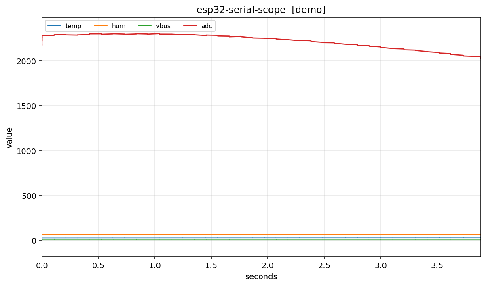

# esp32-serial-scope

**Turn ESP32 serial `key:value` output into live line charts, straight from the
command line.**

No GUI app, no cloud account, no web dashboard. One `pip install`, one command,
and the numbers scrolling past your serial monitor become a chart you can
actually read.

```
temp:23.5,hum:60,vbus:5.02
```

becomes

```
  ---------------------------------------------------------------
  |  temp    hum    vbus        <- one live line per key         |
  |    \      /       \                                          |
  |     \    /         \____                                    |
  ---------------------------------------------------------------
```



> Real output of `esp32-serial-scope --demo --demo-signals 4`. Replace it with a
> screenshot of your own board once you have one (a photo of the chart next to
> the hardware converts better in blog posts).

---

## Why this exists

If you debug sensors on an ESP32, you know the loop:

1. Add `Serial.print` for one more variable.
2. Watch the Arduino IDE serial monitor scroll at 115200 baud.
3. Try to remember what the humidity value was 20 lines ago.
4. Give up and add another `Serial.print`.

Watching numbers scroll is a terrible way to spot a trend, a drop-out, or a
0 reading that should not be 0. And several classic ESP32 bugs are *only*
visible as a shape over time:

- **ADC2 reads 0 once Wi-Fi is on.** ADC2 is shared with the radio, so
  `analogRead()` on an ADC2 pin silently returns garbage while Wi-Fi runs.
  A flat line at zero in the chart makes this obvious in seconds.
- **Supply sag when servos move.** Four SG90s starting together can pull
  600 mA+; the rail dips and the value you were trusting gets noisy.
- **Missing common ground.** PWM looks fine in code and random in reality.
- **Drifting sensor baselines.** The temperature creeps up over an hour and
  you only notice if it is drawn.

`esp32-serial-scope` is a **serial monitor that draws instead of scrolls.**
It reads the same lines you already print, parses the key/value pairs, and
plots them live. Nothing to change on the ESP32 side except the print format.

## Install

Not on PyPI yet. Install from the repository:

```bash
git clone https://github.com/ljn66666/esp32-serial-scope.git
cd esp32-serial-scope
python -m pip install -e .
```

Requires Python 3.9 or newer. Dependencies are just `pyserial` and
`matplotlib`.

## Quick start

**Try it with zero hardware** (a built-in signal generator feeds fake sensors):

```bash
esp32-serial-scope --demo
```

**Try it headless / over SSH** (prints values instead of opening a window):

```bash
esp32-serial-scope --demo --print-only --duration 5
```

**Point it at your board:**

```bash
# Windows
esp32-serial-scope -p COM3

# macOS
esp32-serial-scope -p /dev/cu.usbserial-0001

# Linux
esp32-serial-scope -p /dev/ttyUSB0
```

**Find the port:**

```bash
esp32-serial-scope --list-ports
```

**Log the same run to CSV while you watch:**

```bash
esp32-serial-scope -p COM3 --csv-out bench-run.csv --duration 60
```

**Save a picture for the bug report** (no window needed):

```bash
esp32-serial-scope -p COM3 --duration 30 --save adc2-drift.png
```

## The data format

`esp32-serial-scope` reads one sample per line. Three shapes are supported,
and the format is auto-detected:

| Format | Example line | Notes |
|--------|--------------|-------|
| `key:value` | `temp:23.5,hum:60,vbus:5.02` | pairs split by comma or space |
| `key=value` | `temp=23.5,hum=60` | same idea with `=` |
| plain CSV | `23.5,60,5.02` | name the columns with `--labels temp,hum,vbus` |

A value is read as the first number after the separator, so units are fine:

```
rssi:-62dBm,adc:2048,cpu:80MHz
```

parses to `rssi=-62`, `adc=2048`, `cpu=80`.

Keys must start with a letter or underscore, so a timestamp such as `12:30`
is ignored instead of being plotted as data.

For CSV input, a first line that is all text (`temp,hum,vbus`) is learned as
the header automatically. You can also pin it:

```bash
esp32-serial-scope -p COM3 --mode csv --labels temp,hum,vbus
```

## CLI reference

| Flag | Default | Meaning |
|------|---------|---------|
| `-p, --port` | - | serial port, e.g. `COM3`, `/dev/ttyUSB0` |
| `-b, --baud` | `115200` | baud rate |
| `--demo` | off | use the built-in fake signal generator |
| `--demo-signals N` | `3` | how many demo signals (1-7) |
| `--rate R` | `20` | demo samples per second |
| `--labels a,b,c` | - | column names for CSV input |
| `--mode` | `auto` | `auto`, `kv` or `csv` |
| `--window N` | `300` | points kept in the rolling window |
| `--interval MS` | `100` | redraw interval in milliseconds |
| `--duration S` | `0` | stop after N seconds (`0` = until Ctrl+C) |
| `--pattern RE` | - | only parse lines matching a regex |
| `--timeout S` | `1.0` | serial read timeout |
| `--csv-out FILE` | - | also write samples to CSV |
| `--save FILE` | - | save `.png`/`.svg` (static) or `.gif` (animated) |
| `--print-only` | off | print values, no window |
| `--list-ports` | - | list serial ports and exit |

## ESP32 side

You only need newline-terminated `key:value` lines. See
[`examples/esp32_sender.ino`](examples/esp32_sender.ino) for a ready-to-flash
Arduino sketch. The short version:

```cpp
void loop() {
  float t = readTemperature();
  int   adc = analogRead(A0);
  Serial.printf("temp:%.2f,adc:%d\n", t, adc);
  delay(50);
}
```

Two hardware notes worth repeating, because they cause most of the "the chart
looks wrong" tickets:

- **Use ADC1 pins while Wi-Fi is on.** ADC2 pin numbers differ per chip; on
  ESP32-S3 the ADC2 pins share the radio and read garbage during Wi-Fi.
- **Common ground is mandatory** when your sensors or servos have their own
  supply. Without a shared GND the PWM/analog reference floats.

## Troubleshooting

| Symptom | Fix |
|---------|-----|
| `no serial ports found` | install the USB-serial driver (CP210x, CH34x, FTDI) |
| `cannot open COM3` | the port is open in another monitor; close Arduino IDE |
| Chart is empty | check `--baud`; try `--print-only` to see raw parsed values |
| Values are all zero | you may be on an ADC2 pin with Wi-Fi enabled |
| Window will not open (SSH/headless) | use `--print-only` or `--save chart.png` |
| CSV has fewer columns than expected | the header is fixed by the first sample |

## Roadmap

- `--threshold name:value` alerts drawn as horizontal lines
- `--trigger` freeze-on-condition capture
- a `--json` output mode for piping into Grafana or a notebook

## License

MIT. See [LICENSE](LICENSE).

---

---

# esp32-serial-scope（中文说明）

**把 ESP32 串口里的 `key:value` 数据，直接在命令行里画成实时折线图。**

不需要 GUI 程序、不需要云账号、不需要网页看板。`pip install` 一条命令装好，
一条命令跑起来，那些在串口监视器里刷刷刷滚过去的数字，就变成真正看得懂的曲线。

```
temp:23.5,hum:60,vbus:5.02
```

直接画成三条随时间变化的线。


> 这是 `esp32-serial-scope --demo --demo-signals 4` 的真实输出。等你有了自己的
> 板子，建议换成自己的截图（图 + 实物同框，发文章时更可信）。

---

## 为什么做这个

如果你用 ESP32 调传感器，对这个循环一定不陌生：

1. 再加一条 `Serial.print` 多打一个变量；
2. 盯着 Arduino IDE 串口监视器，115200 波特率一路刷屏；
3. 想回忆 20 行之前湿度到底是多少；
4. 放弃，再加一条 `Serial.print`。

盯着数字滚动，是最难看出趋势、掉点和"本该非零却一直是 0"的方式。
而几个经典的 ESP32 坑，**只有在时间轴上才看得出来**：

- **Wi-Fi 一开，ADC2 读数就变 0。** ADC2 和射频是共享的，Wi-Fi 工作时
  用 `analogRead()` 读 ADC2 引脚会静默返回垃圾值。图上一条贴地的直线，
  十秒钟就能确认这件事。
- **舵机一动，电源就塌陷。** 四颗 SG90 同时启动瞬时电流 600mA+，
  之前信任的读数会突然变噪。
- **共地没连。** PWM 在代码里看着没问题，实物却随机乱抖。
- **传感器基线漂移。** 温度一小时里慢慢爬升，不画出来根本发现不了。

`esp32-serial-scope` 就是**一个会画图、不会滚屏的串口监视器**。
它读你本来就在打印的那些行，解析键值对，实时画出来。
ESP32 那边除了打印格式，什么都不用改。

## 安装

还没发布到 PyPI，从仓库安装：

```bash
git clone https://github.com/ljn66666/esp32-serial-scope.git
cd esp32-serial-scope
python -m pip install -e .
```

需要 Python 3.9 及以上，依赖只有 `pyserial` 和 `matplotlib`。

## 快速上手

**没有硬件也能试**（内置模拟信号发生器）：

```bash
esp32-serial-scope --demo
```

**无图形界面 / SSH 登录也能试**（只打印数值，不开窗口）：

```bash
esp32-serial-scope --demo --print-only --duration 5
```

**指向你的开发板：**

```bash
# Windows
esp32-serial-scope -p COM3

# macOS
esp32-serial-scope -p /dev/cu.usbserial-0001

# Linux
esp32-serial-scope -p /dev/ttyUSB0
```

**先找端口：**

```bash
esp32-serial-scope --list-ports
```

**一边看图一边存 CSV：**

```bash
esp32-serial-scope -p COM3 --csv-out bench-run.csv --duration 60
```

**保存图片，方便贴进 bug 报告**（不需要窗口）：

```bash
esp32-serial-scope -p COM3 --duration 30 --save adc2-drift.png
```

## 数据格式

每行一个采样，支持三种格式，自动识别：

| 格式 | 示例行 | 说明 |
|------|--------|------|
| `key:value` | `temp:23.5,hum:60,vbus:5.02` | 键值对，逗号或空格分隔 |
| `key=value` | `temp=23.5,hum=60` | 用 `=` 分隔，同理 |
| 纯 CSV | `23.5,60,5.02` | 用 `--labels temp,hum,vbus` 指定列名 |

取值时读的是分隔符后的第一个数字，所以带单位也没问题：

```
rssi:-62dBm,adc:2048,cpu:80MHz
```

会解析成 `rssi=-62`、`adc=2048`、`cpu=80`。

键必须以字母或下划线开头，所以 `12:30` 这样的时间戳会被忽略，
而不会被当成数据画出来。

纯 CSV 输入时，第一行如果全是文字（`temp,hum,vbus`）会被自动当作表头。
也可以手动指定：

```bash
esp32-serial-scope -p COM3 --mode csv --labels temp,hum,vbus
```

## 参数速查

| 参数 | 默认值 | 含义 |
|------|--------|------|
| `-p, --port` | - | 串口，如 `COM3`、`/dev/ttyUSB0` |
| `-b, --baud` | `115200` | 波特率 |
| `--demo` | 关 | 使用内置模拟数据 |
| `--demo-signals N` | `3` | 模拟信号数量（1-7） |
| `--rate R` | `20` | 模拟数据每秒采样数 |
| `--labels a,b,c` | - | CSV 输入时的列名 |
| `--mode` | `auto` | `auto` / `kv` / `csv` |
| `--window N` | `300` | 滚动窗口保留的采样点数 |
| `--interval MS` | `100` | 刷新间隔（毫秒） |
| `--duration S` | `0` | 运行 S 秒后自动停止（`0` 表示一直跑到 Ctrl+C） |
| `--pattern RE` | - | 只解析匹配该正则的行 |
| `--timeout S` | `1.0` | 串口读超时 |
| `--csv-out FILE` | - | 同时把采样写入 CSV |
| `--save FILE` | - | 保存 `.png`/`.svg`（静态）或 `.gif`（动画） |
| `--print-only` | 关 | 只打印数值，不开窗口 |
| `--list-ports` | - | 列出串口后退出 |

## ESP32 侧示例

只需要打印以换行结尾的 `key:value` 行。可直接烧录的 Arduino 示例见
[`examples/esp32_sender.ino`](examples/esp32_sender.ino)。核心就几行：

```cpp
void loop() {
  float t = readTemperature();
  int   adc = analogRead(A0);
  Serial.printf("temp:%.2f,adc:%d\n", t, adc);
  delay(50);
}
```

两条硬件提醒，值得重复，因为大多数"图看起来不对"都出在这两点：

- **Wi-Fi 工作时用 ADC1 引脚。** ADC2 引脚编号各芯片不同；ESP32-S3 上
  ADC2 与射频共享，Wi-Fi 开启时会读出垃圾值。
- **传感器或舵机独立供电时，必须共地。** GND 不共用，PWM / 模拟量的
  参考电平就是浮的。

## 常见问题

| 现象 | 处理 |
|------|------|
| `no serial ports found` | 装 USB 转串口驱动（CP210x / CH34x / FTDI） |
| `cannot open COM3` | 端口被别处占用，先关掉 Arduino IDE 的串口监视器 |
| 图是空的 | 检查 `--baud`；用 `--print-only` 看原始解析值 |
| 数值全是 0 | 可能正开 Wi-Fi 且读的是 ADC2 引脚 |
| 开不了窗口（SSH/无桌面） | 改用 `--print-only` 或 `--save chart.png` |
| CSV 列数比预期少 | 表头由第一个采样固定，后续新列会被忽略 |

## 开发计划

- `--threshold name:value` 画阈值横线做告警
- `--trigger` 满足条件时冻结并抓取一段
- `--json` 输出，方便接 Grafana 或 notebook

## 许可证

MIT，详见 [LICENSE](LICENSE)。
